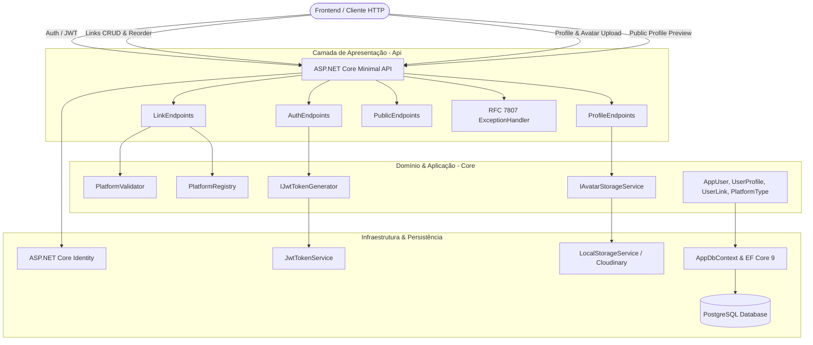
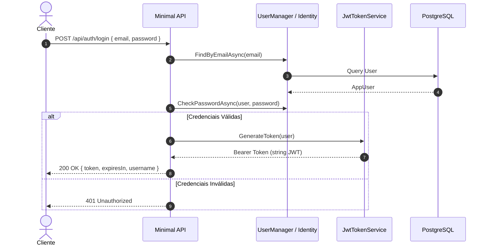

# 03. Arquitetura e Design Técnico

## 1. Visão Geral da Arquitetura

A arquitetura do **devlinks (Link-Sharing App)** foi desenhada para atender aos requisitos de uma aplicação Full-Stack com separação estrita de responsabilidades, alta coesão e facilidade de teste.

A aplicação adota **ASP.NET Core Minimal APIs** no .NET 9, organizadas em camadas desacopladas (_Clean Architecture / Vertical Slice approach_), garantindo que a lógica de negócios e as regras de validação permaneçam isoladas da infraestrutura de dados e dos mecanismos de entrega HTTP.



---

## 2. Estrutura da Solution e Organização dos Projetos

A solution adota a convenção padrão do .NET com separação clara de responsabilidades:

```
devlinks / DevLinks/
├── .github/
│   └── workflows/
│       └── ci.yml                         # Pipeline de CI (Build, Format, Tests)
├── docs/                                  # Especificações completas de engenharia
├── src/
│   ├── DevLinks.Api/                      # Ponto de entrada da API (Minimal APIs, DTOs, Handlers)
│   │   ├── Common/
│   │   │   ├── Errors/                    # GlobalExceptionHandler (RFC 7807)
│   │   │   └── Extensions/                # DependencyInjectionExtensions
│   │   ├── Endpoints/
│   │   │   ├── AuthEndpoints.cs           # /api/auth (register, login, me)
│   │   │   ├── LinkEndpoints.cs           # /api/links (get, batch put, delete)
│   │   │   ├── ProfileEndpoints.cs        # /api/profile (get, put, upload avatar)
│   │   │   ├── PublicEndpoints.cs         # /api/public/{username} (preview público)
│   │   │   └── HealthEndpoints.cs         # /healthz
│   │   ├── appsettings.json
│   │   ├── appsettings.Development.json
│   │   ├── Dockerfile
│   │   └── Program.cs
│   │
│   ├── DevLinks.Core/                     # Entidades de Domínio, Enums, Regras de Negócio e Interfaces
│   │   ├── Entities/
│   │   │   ├── AppUser.cs                 # Identidade e autenticação
│   │   │   ├── UserProfile.cs             # Nome, sobrenome, email público, avatar
│   │   │   └── UserLink.cs                # Plataforma, URL e DisplayOrder
│   │   ├── Enums/
│   │   │   └── PlatformType.cs            # Enum das 14 plataformas oficiais
│   │   ├── Platforms/
│   │   │   ├── PlatformDefinition.cs      # Metadados (Nome, Cor, Regex, Placeholder)
│   │   │   └── PlatformRegistry.cs        # Catálogo centralizado das plataformas
│   │   ├── Interfaces/
│   │   │   ├── IAvatarStorageService.cs
│   │   │   ├── IJwtTokenGenerator.cs
│   │   │   └── IPlatformValidator.cs
│   │   └── Services/
│   │       └── PlatformValidator.cs
│   │
│   └── DevLinks.Infrastructure/           # Persistência EF Core, Identity, Storage e JWT
│       ├── Data/
│       │   ├── AppDbContext.cs
│       │   └── Configurations/
│       │       ├── UserProfileConfiguration.cs
│       │       └── UserLinkConfiguration.cs
│       ├── Identity/
│       │   └── JwtTokenGenerator.cs
│       ├── Storage/
│       │   └── LocalAvatarStorageService.cs
│       └── Migrations/
│
├── tests/
│   ├── DevLinks.UnitTests/                # Testes unitários puros (Validação, Reordenação, Perfil)
│   └── DevLinks.IntegrationTests/         # Testes de integração (WebApplicationFactory + Testcontainers)
│
├── docker-compose.yml                     # Orquestração local (API + PostgreSQL)
├── .dockerignore
├── .gitignore
└── README.md
```

---

## 3. Catálogo de Plataformas e Estratégia de Validação

O Frontend Mentor estabelece que a aplicação deve validar se a URL informada pelo usuário pertence à plataforma escolhida e segue o padrão correto.

Para evitar código duplicado e acoplamento, implementa-se o padrão **Registry / Strategy**:

### 3.1 Definição da Plataforma (`PlatformDefinition`)

```csharp
namespace DevLinks.Core.Platforms;

public sealed record PlatformDefinition(
    string Id,
    string Name,
    string ColorHex,
    string UrlPatternRegex,
    string Placeholder,
    string IconSvgName);
```

### 3.2 Registro Centralizado (`PlatformRegistry`)

O `PlatformRegistry` centraliza os metadados das 14 plataformas oficiais do desafio:

```csharp
namespace DevLinks.Core.Platforms;

public static class PlatformRegistry
{
    private static readonly Dictionary<string, PlatformDefinition> Platforms = new(StringComparer.OrdinalIgnoreCase)
    {
        ["github"] = new("github", "GitHub", "#1A1A1A",
            @"^https?:\/\/(www\.)?github\.com\/[a-zA-Z0-9_\-]+(\/)?$",
            "https://github.com/johnappleseed", "icon-github"),

        ["frontendmentor"] = new("frontendmentor", "Frontend Mentor", "#FFFFFF",
            @"^https?:\/\/(www\.)?frontendmentor\.io\/profile\/[a-zA-Z0-9_\-]+(\/)?$",
            "https://www.frontendmentor.io/profile/johnappleseed", "icon-frontend-mentor"),

        ["twitter"] = new("twitter", "Twitter", "#43B7E9",
            @"^https?:\/\/(www\.)?(twitter|x)\.com\/[a-zA-Z0-9_]{1,15}(\/)?$",
            "https://x.com/johnappleseed", "icon-twitter"),

        ["linkedin"] = new("linkedin", "LinkedIn", "#2D68FF",
            @"^https?:\/\/(www\.)?linkedin\.com\/in\/[a-zA-Z0-9_\-]+(\/)?$",
            "https://www.linkedin.com/in/johnappleseed", "icon-linkedin"),

        ["youtube"] = new("youtube", "YouTube", "#EE3939",
            @"^https?:\/\/(www\.)?youtube\.com\/(@[a-zA-Z0-9_\-]+|channel\/[a-zA-Z0-9_\-]+)(\/)?$",
            "https://www.youtube.com/@johnappleseed", "icon-youtube"),

        ["facebook"] = new("facebook", "Facebook", "#2442AC",
            @"^https?:\/\/(www\.)?facebook\.com\/[a-zA-Z0-9\.]+(\/)?$",
            "https://www.facebook.com/johnappleseed", "icon-facebook"),

        ["twitch"] = new("twitch", "Twitch", "#EE3FC8",
            @"^https?:\/\/(www\.)?twitch\.tv\/[a-zA-Z0-9_]+(\/)?$",
            "https://www.twitch.tv/johnappleseed", "icon-twitch"),

        ["devto"] = new("devto", "Dev.to", "#333333",
            @"^https?:\/\/(www\.)?dev\.to\/[a-zA-Z0-9_\-]+(\/)?$",
            "https://dev.to/johnappleseed", "icon-devto"),

        ["codewars"] = new("codewars", "Codewars", "#8A1A50",
            @"^https?:\/\/(www\.)?codewars\.com\/users\/[a-zA-Z0-9_\-]+(\/)?$",
            "https://www.codewars.com/users/johnappleseed", "icon-codewars"),

        ["codepen"] = new("codepen", "Codepen", "#302267",
            @"^https?:\/\/(www\.)?codepen\.io\/[a-zA-Z0-9_\-]+(\/)?$",
            "https://codepen.io/johnappleseed", "icon-codepen"),

        ["freecodecamp"] = new("freecodecamp", "freeCodeCamp", "#302267",
            @"^https?:\/\/(www\.)?freecodecamp\.org\/[a-zA-Z0-9_\-]+(\/)?$",
            "https://www.freecodecamp.org/johnappleseed", "icon-freecodecamp"),

        ["gitlab"] = new("gitlab", "GitLab", "#EB4925",
            @"^https?:\/\/(www\.)?gitlab\.com\/[a-zA-Z0-9_\-]+(\/)?$",
            "https://gitlab.com/johnappleseed", "icon-gitlab"),

        ["hashnode"] = new("hashnode", "Hashnode", "#0330D1",
            @"^https?:\/\/(www\.)?hashnode\.com\/@[a-zA-Z0-9_\-]+(\/)?$",
            "https://hashnode.com/@johnappleseed", "icon-hashnode"),

        ["stackoverflow"] = new("stackoverflow", "Stack Overflow", "#EC7100",
            @"^https?:\/\/(www\.)?stackoverflow\.com\/users\/[0-9]+(\/[a-zA-Z0-9_\-]+)?(\/)?$",
            "https://stackoverflow.com/users/12345/johnappleseed", "icon-stack-overflow")
    };

    public static bool TryGetPlatform(string platformId, out PlatformDefinition platform) =>
        Platforms.TryGetValue(platformId, out platform!);

    public static IEnumerable<PlatformDefinition> GetAll() => Platforms.Values;
}
```

---

## 4. Pipeline de Autenticação com JWT e ASP.NET Core Identity

A autenticação é gerenciada utilizando **ASP.NET Core Identity** em conjunto com tokens **JWT Bearer**.



### Claims do Token:

- `sub` (Subject): Identificador único do usuário (`UserId`).
- `email`: E-mail autenticado.
- `name`: Nome de usuário (`UserName`).
- `jti`: Identificador único do token (para prevenção de replay).

---

## 5. Estratégia de Salvamento e Reordenação em Lote de Links

O usuário pode adicionar novos links, alterar URLs existentes, excluir links e alterar a ordem através de _drag-and-drop_. Ao clicar no botão **Save**, o frontend envia o estado completo da lista para `PUT /api/links`.

### Mecanismo de Sincronização Atômica:

1. **Início da Transação:** Abre transação isolada no PostgreSQL via EF Core.
2. **Carregamento dos Links Existentes:** Busca os links pertencentes ao `UserId`.
3. **Detecção de Remoções:** Links no banco que não estão no payload são removidos.
4. **Atualização & Inserção:** Links existentes no payload têm sua `Platform`, `Url` e `DisplayOrder` atualizadas; links novos (sem `Id` ou com `Id` temporário) são inseridos.
5. **Normalização de Ordem:** Garante que o `DisplayOrder` seja indexado sequencialmente de $0$ a $N-1$.
6. **Commit:** Validações de regex são checadas antes da gravação; falhas abortam a transação inteira retornando `400 Bad Request` com lista detalhada de erros.

---

## 6. Arquitetura de Armazenamento de Avatares (Media Storage)

O upload de avatares utiliza a interface `IAvatarStorageService`:

```csharp
namespace DevLinks.Core.Interfaces;

public interface IAvatarStorageService
{
    Task<string> SaveAvatarAsync(Stream fileStream, string fileName, string contentType, CancellationToken cancellationToken = default);
    Task DeleteAvatarAsync(string avatarUrl, CancellationToken cancellationToken = default);
}
```

### Regras de Segurança no Upload:

1. **Verificação de Extensão e MIME Type:** Permitido apenas `image/jpeg` e `image/png`.
2. **Tamanho Máximo do Arquivo:** 2 MB.
3. **Renomeação Segura:** O arquivo é salvo com nome gerado via `Guid.NewGuid()` + extensão sanitizada (ex: `a8f9b2c3-4d5e-6f7a-8b9c-0d1e2f3a4b5c.png`) para evitar ataques de _Directory Traversal_ e colisão de nomes.
4. **Armazenamento:**
   - Em desenvolvimento: Pasta local servida estaticamente via middleware `UseStaticFiles`.
   - Em produção: Suporte desacoplado a provedores como Cloudinary ou Azure Blob Storage.

---

## 7. Tratamento Global de Erros (RFC 7807 ProblemDetails)

A API adota a interface `IExceptionHandler` do ASP.NET Core:

- **Erros de Validação:** `400 Bad Request` com o dicionário `errors` especificando campos e mensagens.
- **Falha de Autenticação:** `401 Unauthorized`.
- **Acesso Negado a Recurso Alheio:** `403 Forbidden` ou `404 Not Found`.
- **Usuário / Recurso Inexistente:** `404 Not Found`.
- **Conflito de E-mail / Dados:** `409 Conflict`.
- **Exceções Inesperadas:** `500 Internal Server Error` com `TraceId` e ocultação de detalhes em produção.

---

## 8. Documentação Interativa com OpenAPI e Scalar

A API utiliza o pacote oficial do .NET 9 `Microsoft.AspNetCore.OpenApi` em conjunto com `Scalar.AspNetCore`:

```csharp
builder.Services.AddOpenApi();

if (app.Environment.IsDevelopment())
{
    app.MapOpenApi();
    app.MapScalarApiReference(options =>
    {
        options.Title = "devlinks API Reference";
        options.Theme = ScalarTheme.Purple;
    });
}
```

A interface gráfica de testes e exploração da API fica acessível em `/scalar/v1`.
