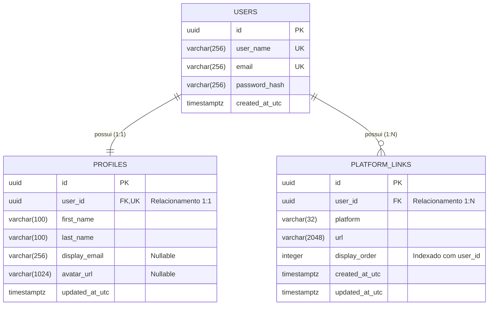

# 04. Modelo de Dados e Persistência

## 1. Visão Geral do Modelo de Dados

O modelo de dados do **devlinks (Link-Sharing App)** foi desenhado para estruturar com integridade referencial e alta performance as três dimensões centrais da aplicação:

1. **Identidade e Autenticação (`Users`):** Contas cadastradas via ASP.NET Core Identity.
2. **Dados Pessoais e Apresentação (`Profiles`):** Nome, sobrenome, e-mail de exibição e foto de avatar.
3. **Coleção de Links Sociais (`PlatformLinks`):** Links para plataformas externas com ordem de exibição sequencial (_drag-and-drop_).



---

## 2. Entidades de Domínio

### 2.1 Entidade de Identidade: `AppUser`

Representa o usuário registrado no sistema, herdando as funcionalidades de segurança do ASP.NET Core Identity.

```csharp
using Microsoft.AspNetCore.Identity;

namespace UrlShortener.Core.Entities;

public sealed class AppUser : IdentityUser<Guid>
{
    public DateTimeOffset CreatedAtUtc { get; private set; } = DateTimeOffset.UtcNow;

    // Propriedades de navegação do EF Core
    public UserProfile? Profile { get; private set; }
    public ICollection<UserLink> Links { get; private set; } = new List<UserLink>();

    private AppUser() { }

    public static AppUser Create(string email, string userName)
    {
        return new AppUser
        {
            Id = Guid.NewGuid(),
            Email = email,
            UserName = userName,
            NormalizedEmail = email.ToUpperInvariant(),
            NormalizedUserName = userName.ToUpperInvariant(),
            CreatedAtUtc = DateTimeOffset.UtcNow
        };
    }
}
```

---

### 2.2 Entidade de Perfil: `UserProfile`

Contém os detalhes do perfil do desenvolvedor consumidos na aba _Profile Details_ e exibidos na tela de _Preview_.

| Campo          | Tipo C#          | Tipo PostgreSQL | Nulo? | Descrição                                        |
| :------------- | :--------------- | :-------------- | :---- | :----------------------------------------------- |
| `Id`           | `Guid`           | `UUID`          | Não   | Chave primária do perfil.                        |
| `UserId`       | `Guid`           | `UUID`          | Não   | Chave estrangeira única vinculada a `Users(Id)`. |
| `FirstName`    | `string`         | `VARCHAR(100)`  | Não   | Primeiro nome (obrigatório pelo desafio).        |
| `LastName`     | `string`         | `VARCHAR(100)`  | Não   | Sobrenome (obrigatório pelo desafio).            |
| `DisplayEmail` | `string?`        | `VARCHAR(256)`  | Sim   | E-mail opcional de contato exibido no preview.   |
| `AvatarUrl`    | `string?`        | `VARCHAR(1024)` | Sim   | URL ou caminho relativo da foto de avatar.       |
| `UpdatedAtUtc` | `DateTimeOffset` | `TIMESTAMPTZ`   | Não   | Timestamp da última atualização em UTC.          |

```csharp
namespace UrlShortener.Core.Entities;

public sealed class UserProfile
{
    public Guid Id { get; private set; }
    public Guid UserId { get; private set; }
    public string FirstName { get; private set; } = string.Empty;
    public string LastName { get; private set; } = string.Empty;
    public string? DisplayEmail { get; private set; }
    public string? AvatarUrl { get; private set; }
    public DateTimeOffset UpdatedAtUtc { get; private set; }

    public AppUser? User { get; private set; }

    private UserProfile() { }

    public static UserProfile Create(Guid userId, string firstName = "", string lastName = "", string? displayEmail = null)
    {
        return new UserProfile
        {
            Id = Guid.NewGuid(),
            UserId = userId,
            FirstName = firstName,
            LastName = lastName,
            DisplayEmail = displayEmail,
            UpdatedAtUtc = DateTimeOffset.UtcNow
        };
    }

    public void UpdateDetails(string firstName, string lastName, string? displayEmail)
    {
        ArgumentException.ThrowIfNullOrWhiteSpace(firstName);
        ArgumentException.ThrowIfNullOrWhiteSpace(lastName);

        FirstName = firstName.Trim();
        LastName = lastName.Trim();
        DisplayEmail = string.IsNullOrWhiteSpace(displayEmail) ? null : displayEmail.Trim();
        UpdatedAtUtc = DateTimeOffset.UtcNow;
    }

    public void UpdateAvatar(string avatarUrl)
    {
        AvatarUrl = avatarUrl;
        UpdatedAtUtc = DateTimeOffset.UtcNow;
    }
}
```

---

### 2.3 Entidade de Link: `UserLink`

Armazena cada link individual adicionado na aba _Customize your links_.

| Campo          | Tipo C#          | Tipo PostgreSQL | Nulo? | Descrição                                               |
| :------------- | :--------------- | :-------------- | :---- | :------------------------------------------------------ |
| `Id`           | `Guid`           | `UUID`          | Não   | Chave primária do link.                                 |
| `UserId`       | `Guid`           | `UUID`          | Não   | Chave estrangeira vinculada a `Users(Id)`.              |
| `Platform`     | `string`         | `VARCHAR(32)`   | Não   | Identificador da plataforma (ex: `github`, `linkedin`). |
| `Url`          | `string`         | `VARCHAR(2048)` | Não   | URL de destino do desenvolvedor.                        |
| `DisplayOrder` | `int`            | `INTEGER`       | Não   | Índice de ordenação da lista (0, 1, 2...).              |
| `CreatedAtUtc` | `DateTimeOffset` | `TIMESTAMPTZ`   | Não   | Data de criação do link.                                |
| `UpdatedAtUtc` | `DateTimeOffset` | `TIMESTAMPTZ`   | Não   | Data da última alteração.                               |

```csharp
namespace UrlShortener.Core.Entities;

public sealed class UserLink
{
    public Guid Id { get; private set; }
    public Guid UserId { get; private set; }
    public string Platform { get; private set; } = string.Empty;
    public string Url { get; private set; } = string.Empty;
    public int DisplayOrder { get; private set; }
    public DateTimeOffset CreatedAtUtc { get; private set; }
    public DateTimeOffset UpdatedAtUtc { get; private set; }

    public AppUser? User { get; private set; }

    private UserLink() { }

    public static UserLink Create(Guid userId, string platform, string url, int displayOrder)
    {
        return new UserLink
        {
            Id = Guid.NewGuid(),
            UserId = userId,
            Platform = platform.ToLowerInvariant(),
            Url = url.Trim(),
            DisplayOrder = displayOrder,
            CreatedAtUtc = DateTimeOffset.UtcNow,
            UpdatedAtUtc = DateTimeOffset.UtcNow
        };
    }

    public void Update(string platform, string url, int displayOrder)
    {
        Platform = platform.ToLowerInvariant();
        Url = url.Trim();
        DisplayOrder = displayOrder;
        UpdatedAtUtc = DateTimeOffset.UtcNow;
    }
}
```

---

## 3. Mapeamento com Entity Framework Core (Fluent API)

### 3.1 Configuração de Perfil (`UserProfileConfiguration`)

```csharp
using Microsoft.EntityFrameworkCore;
using Microsoft.EntityFrameworkCore.Metadata.Builders;
using UrlShortener.Core.Entities;

namespace UrlShortener.Infrastructure.Data.Configurations;

public sealed class UserProfileConfiguration : IEntityTypeConfiguration<UserProfile>
{
    public void Configure(EntityTypeBuilder<UserProfile> builder)
    {
        builder.ToTable("Profiles");

        builder.HasKey(p => p.Id);

        builder.Property(p => p.FirstName)
            .IsRequired()
            .HasMaxLength(100);

        builder.Property(p => p.LastName)
            .IsRequired()
            .HasMaxLength(100);

        builder.Property(p => p.DisplayEmail)
            .HasMaxLength(256)
            .IsRequired(false);

        builder.Property(p => p.AvatarUrl)
            .HasMaxLength(1024)
            .IsRequired(false);

        builder.Property(p => p.UpdatedAtUtc)
            .IsRequired();

        // Relacionamento 1:1 com AppUser
        builder.HasOne(p => p.User)
            .WithOne(u => u.Profile)
            .HasForeignKey<UserProfile>(p => p.UserId)
            .OnDelete(DeleteBehavior.Cascade);

        builder.HasIndex(p => p.UserId)
            .IsUnique()
            .HasDatabaseName("IX_Profiles_UserId");
    }
}
```

### 3.2 Configuração de Links (`UserLinkConfiguration`)

```csharp
using Microsoft.EntityFrameworkCore;
using Microsoft.EntityFrameworkCore.Metadata.Builders;
using UrlShortener.Core.Entities;

namespace UrlShortener.Infrastructure.Data.Configurations;

public sealed class UserLinkConfiguration : IEntityTypeConfiguration<UserLink>
{
    public void Configure(EntityTypeBuilder<UserLink> builder)
    {
        builder.ToTable("PlatformLinks");

        builder.HasKey(l => l.Id);

        builder.Property(l => l.Platform)
            .IsRequired()
            .HasMaxLength(32);

        builder.Property(l => l.Url)
            .IsRequired()
            .HasMaxLength(2048);

        builder.Property(l => l.DisplayOrder)
            .IsRequired();

        builder.Property(l => l.CreatedAtUtc)
            .IsRequired();

        builder.Property(l => l.UpdatedAtUtc)
            .IsRequired();

        // Relacionamento 1:N com AppUser
        builder.HasOne(l => l.User)
            .WithMany(u => u.Links)
            .HasForeignKey(l => l.UserId)
            .OnDelete(DeleteBehavior.Cascade);

        // Índice composto para buscar os links do usuário já ordenados
        builder.HasIndex(l => new { l.UserId, l.DisplayOrder })
            .HasDatabaseName("IX_PlatformLinks_UserId_DisplayOrder");
    }
}
```

---

## 4. Estratégia de Índices e Performance no PostgreSQL

1. **`IX_PlatformLinks_UserId_DisplayOrder` (Composto B-Tree):**
   - Garante que a consulta `WHERE UserId = @userId ORDER BY DisplayOrder ASC` seja executada via _Index Scan_, eliminando a necessidade de ordenação em memória no banco.
2. **`IX_Profiles_UserId` (Único):**
   - Assegura integridade física de 1:1 entre usuário e perfil.
3. **`IX_Users_NormalizedEmail` e `IX_Users_NormalizedUserName`:**
   - Garantem que a busca por login e a verificação de duplicidade sejam $O(\log N)$.

### DDL SQL Equivalente no PostgreSQL

```sql
-- Tabela de Perfis
CREATE TABLE "Profiles" (
    "Id" UUID NOT NULL PRIMARY KEY,
    "UserId" UUID NOT NULL UNIQUE REFERENCES "AspNetUsers"("Id") ON DELETE CASCADE,
    "FirstName" VARCHAR(100) NOT NULL,
    "LastName" VARCHAR(100) NOT NULL,
    "DisplayEmail" VARCHAR(256) NULL,
    "AvatarUrl" VARCHAR(1024) NULL,
    "UpdatedAtUtc" TIMESTAMPTZ NOT NULL
);

-- Tabela de Links
CREATE TABLE "PlatformLinks" (
    "Id" UUID NOT NULL PRIMARY KEY,
    "UserId" UUID NOT NULL REFERENCES "AspNetUsers"("Id") ON DELETE CASCADE,
    "Platform" VARCHAR(32) NOT NULL,
    "Url" VARCHAR(2048) NOT NULL,
    "DisplayOrder" INTEGER NOT NULL,
    "CreatedAtUtc" TIMESTAMPTZ NOT NULL,
    "UpdatedAtUtc" TIMESTAMPTZ NOT NULL
);

-- Índice de ordenação dos links
CREATE INDEX "IX_PlatformLinks_UserId_DisplayOrder"
ON "PlatformLinks" ("UserId", "DisplayOrder");
```

---

## 5. Fluxo de Migrations com EF Core CLI

O versionamento do banco de dados é controlado pelas migrações do EF Core:

```bash
# Adicionar a migração inicial das tabelas
dotnet ef migrations add InitialCreate \
  --project src/UrlShortener.Infrastructure \
  --startup-project src/UrlShortener.Api

# Aplicar migrações ao banco local ou de teste
dotnet ef database update \
  --project src/UrlShortener.Infrastructure \
  --startup-project src/UrlShortener.Api

# Gerar script SQL idempotente para produção
dotnet ef migrations script --idempotent \
  --project src/UrlShortener.Infrastructure \
  --startup-project src/UrlShortener.Api \
  --output migrations.sql
```
